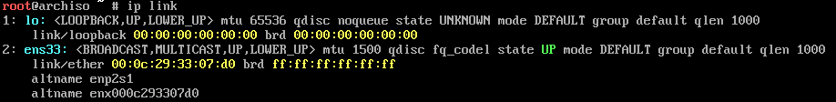
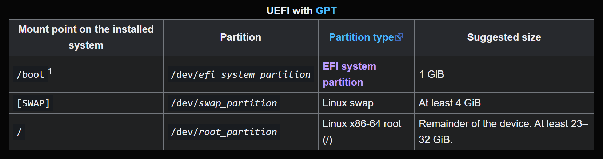

# My Arch Install Documentation

by Ben Burgess

I will organize my documentation to match the [install wiki](https://wiki.archlinux.org/title/Installation_guide).
Section header and subheader numbers will match those in the wiki.
It's worth noting that I'm doing all of this on a **Windows 11 laptop**, with **VMWare Workstation Pro** as my hypervisor.

## 1 Pre-Installation

### 1.1 Acquire an installation image

I visited [the download site](https://archlinux.org/download/) and downloaded the archlinux-2026.10.01-x86_64.iso file from the **arizona.edu** mirror.

### 1.2 Verify Signature

I downloaded the **PGP signature** from the download site as well and ran the following commands in **WSL** to verify the iso.

`sq network wkd search pierre@archlinux.org --output release-key.pgp`

`sq verify --signer-file release-key.pgp --signature-file archlinux-2026.10.01-x86_64.iso.sig archlinux-2026.10.01-x86_64.iso`

The verify comand produced the following output:

`Authenticated signature made by`
`3E80CA1A8B89F69CBA57D98A76A5EF9054449A5C (Pierre Schmitz`
`<pierre@archlinux.org>)`

`1 authenticated signature.`

### 1.3 Prepare an installation medium

My installation medium is **VMWare Workstation Pro**. To prepare it for this installation process, I gave it a good pep talk and read it its favorite **bedtime story**.

### 1.4 Boot the live environment

In VMWare, I selected **File->Create new Virtual Machine** open the setup wizard for making a new virtual machine.
I selected my iso image and selected **Linux** for the OS and **Other Linux 6.x kernel 64-bit** for the version.
This was [Google's](https://google.com) suggestion when making an Arch VM.

I named my VM **Dirtmouth** because [I'm a nerd](https://hollowknight.wiki/w/Dirtmouth). I gave it **32 GBs** of Disk space and finished creating the VM.

Before powering on the virtual machine, I went into my VMWare settings and set it to boot using **UEFI**, not **BIOS**, and made sure that **Secure Boot** was unchecked.

I selected **Arch Linux install medium** and waited for the installation to complete.

### 1.5 Set the console keyboard layout and font

I left these as default.  One of these years I'm gonna learn **Dvorak**.  Probably the same year I manually install Arch.

Wait.

### 1.6 Verify the boot mode

I ran the following command:

`cat /sys/firmware/efi/fw_platform_size`

and got **64**, which correctly verified that the vm booted in UEFI with a 64-bit x64 UEFI.

### 1.7 Connect to the internet

I ran `ip link` and got the following output:

Notice that the ethernet connection was up by default.  This is very convenient for me.  I am now happy.

The `ping` command was a success, further confirming the internet was attached succesfully.

### 1.8 Update the system clock

I ran the `timedatectl` command, showing that the system time had in fact successfully synchronized.

### 1.9 Partition the disks

I ran `fdisk /dev/sda` to create and modify the partition table. I chose to go with the basic set of partitions the wiki recommends for UEFI with GPT, as shown below:

Within fdisk, I ran the following commands:

- `g`: make a new empty GPT table
- Make the EFI system partition
  - `n`: make the new partition
  - `1` to set it's number
  - `<Enter>` to set the start index to the default
  - `+1G` to set the size to 1 GB
  - `t` and then `<Enter>` to change its type
  - `1` to set the partition type accordingly
- Make the Linux swap partition
  - `n`: make the new partition
  - `2` to set it's number
  - `<Enter>` to set the start index to the default
  - `+4G` to set the size to 4 GB
  - `t` and then `<Enter>` to change its type
  - `swap` to set the partition type accordingly
- Make the Linux root filesystem partition
  - `n`: make the new partition
  - `3` to set it's number
  - `<Enter>` to set the start index to the default
  - `<Enter>` to set the size to all remaining disk space
  - `t` and then `<Enter>` to change its type
  - `linux-root-64` to set the partition type accordingly
- `p` to check all the partition data before writing it
  - Important to note, I didn't change the default partition names, so they're just `/dev/sda(1,2,and 3)`, respectively
- `w` to write it to disk

This was largely the same as when I did it for my Void linux install for our first assignment.

### 1.10 Format the partitions

I ran the following commands to create the filesystems on each of the partitions:

- `mkfs.fat -F 32 /dev/sda1`
- `mkswap /dev/sda2`
- `mkfs.ext4 /dev/sda3`

### 1.11 Mount the file systems

I ran the following commands to mount the filesystems:

- `mount --mkdir /dev/sda3 /mnt`
  - to mount the root volume
- `mount --mkdir /dev/sda1 /mnt/boot`
  - to mount the EFI system partition
- `swapon /dev/sda2`
  - to activate the swap partition

## 2 Installation

### 2.1 Select the mirrors

I edited the `/etc/pacman.d/mirrorlist` file so that **arizona.edu** is the top one.

This doesn't really matter I don't think, but I figured it would be worth matching to the mirror I originally downloaded from.

### 2.2 Install essential packages

I read the recommendations and settled on the following packages to set up to install on my **VM**:
- `base`: mandatory, includes lots of stuff required for the command line to work
- `linux`: the kernel, basically mandatory
- `linux-headers`: also related to the kernel
- `linux-firmware`: related to the firmware
- `intel-ucode`: security/bugfix package
- `networkmanager`: exactly what it says on the tin
- `nano` and `vim`: obviously useful
- `man-db` and `man-pages`: very useful
- `sudo`: idk why this isn't installed by default
- `git` and `base-devel`: I'm considering using this vm for another class where I need to try various multiprogramming things on various different systems with different processor counts and stuff, so this will help set up for that

So the final command ends up being:

`pacstrap -K /mnt base linux linux-headers linux-firmware intel-ucode networkmanager nano vim man-db man-pages sudo git base-devel`

This took about a minute and a half to run.

## 3 Configure the system

### 3.1 Fstab

I generated the rows of the **fstab file** at `/etc/fstab` with the following command:
- `genfstab -U /mnt >> /mnt/etc/fstab`

I then went and checked the fstab file to make sure it worked correctly.  All the auto-generated fields matched the example ones from the wiki, so I figured I must have done something right.

### 3.2 Chroot

`arch-chroot -S /mnt` exactly as the wiki suggests.

### 3.3 Time

I ran `ln -sf /usr/share/zoneinfo/America/Chicago /etc/localtime` to set the time zone.

This reminded me of last November when I went with Codi to Chicago. Fun times.

I ran `hwclock --systohc`, and then ran `date` to make sure the time zone was set up correctly.

The wiki says to set up time synchronization with some **NTP client**, but I'll do that later once I have the VM reliably booting.

### 3.4 Localization

I edited the `/etc/locale.gen` file to uncomment `en_US.UTF-8 UTF-8`, as Google said that that was the default locale in America, and also the one in the wiki. I ran `locale-gen` to actually then generate it.

I set the default language in `/etc/locale.conf` to `en_US.UTF-8` as well to make it persistent.

I did not change the keyboard layout, so I skipped that part.

### 3.5 Network Configuration

I set the system's hostname in `/etc/hostname` to **dirtmouth**, to match the name of the VM.

I will enable **NetworkManager** later once I'm not in a chroot environment and so can actually use **systemd**.

### 3.6 Intramfs

I didn't change the system keyboard, so I don't have to worry about this.

I like that decision more and more as I go through this.

### 3.7 Root password

I set a password for root using `passwd`.

I'm not going to tell you what it is.

### 3.8 Boot loader

I selected **GRUB** as my bootloader, because it is the most common and default option and it's 1am and I don't want to do anything more advanced than that.

I ran the following 3 commands:

- `pacman -S grub efibootmgr`
  - This installs the GRUB package
- `grub-install --target=x86_64-efi --efi-directory=/boot --bootloader-id=GRUB`
  - This actually puts the GRUB bootloader on the EFI partition
- `grub-mkconfig -o /boot/grub/grub.cfg`
  - This generates the config file for GRUB

## 4 Reboot

I exited the **chroot** session and `reboot`ed the machine. I logged in as root, and my VM succesfully has Arch installed!!!

## 5 Post-installation

I will now switch my numbering to reflect the post-installation steps specified on Harvey.

First, however, I have to enable two systemd functions: `timesyncd` and `NetworkManager`, with the following commands:
- `systemctl enable --now systemd-timesyncd`
  - Followed by a status check
- `systemctl enable --now NetworkManager`
  - Same

### 5.1 Install a DE

I chose to install **LXQt** becuase I'm tired and it's what you suggested.

I started by installing **xorg** as the window system that will be able to the run the window manager.

I then installed the following:
- **lxqt**: the DE itself
- **openbox**: the window manager
- **qterminal**: the terminal emulator
- **mesa**: something about graphics acceleration, the wiki recommended it

I then tried to configure and run **lxqt**, which apparently was a mistake since you're not supposed to do that as root.  So I made a user account for myself and for Codi (password everett) then tried again.

I named my user account **benjamin** and gave it sudo permissions.  It's worth noting that at this point I had to go change the sudoers file to automatically allow the wheel group sudoer access.

Then, in my user account, I ran the following commands:
- `cp /etc/X11/xinit/xinitrc ~/.xinitrc`
  - This copies the xinit script to my home directory
- `echo "exec startlxqt" >> .xinitrc`
  - This puts the command to start up lxqt at the end of the initialization script
- `startx`
  - Actually start it

Startx ended up being super annoying and kept not doing what I wanted it to so I switched to using a **Display Manager**, specifically **sddm**. I installed and enabled it, which then launched the desktop environment.

I confirmed that after rebooting the VM, it goes directly into the **LXQt** desktop environment.

### 5.2 User accounts

I already created a new user account for myself and for Codi, but I added a few more as listed below:

- **elderbug**
- **iselda**
- **bretta**
- **sly**
- **the_last_stag**

I added passwords for all of the above as well.

### 5.3 Install another shell

I chose **zsh** as my alternate shell, because the name sounds cool. I first installed it with `pacman`, and then launched it with `zsh`.

I decided to set it as my default shell because I can.  I did this with the following command I ripped from Google:

`chsh -s $(which zsh)`

### 5.4 Install Ssh

This was a simple matter of **pacman install** + **systemctl enable**.  Very simple.  Barely an inconvenience.

### 5.5 Color-coded terminal

First, I added some aliases/commands to the .zshrc file, as shown below:
- `autoload -U colors && colors`
- `alias ls='ls --color=auto`
- `alias lsa='ls -lah --color=auto`
- `alias grep='grep --color=auto`
- `alias diff='diff --color=auto`
- `source /usr/share/zsh-syntax-highlighting/zsh-syntax-highlighting.zsh`
  - This one also required me to install the zsh-syntax-highlighting package.
    - This ended up sending me down a 2-hr rabbit hole because it crashed my networking the first time and it took forever to figure out how to fix all of it.

### 5.6 Make GUI default

Oh I already did this. Sweet.

### 5.7 Aliases. Alii?

I already added a few to the `.zshrc` file, but I added some more as shown below:

- `up`: `cd ..`
- `upgrade`: `sudo pacman -Syu`
- `uptime`: `uptime --pretty`
